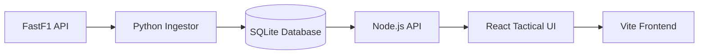

# 🏎️ F1 TELEMETRY PRO: Tactical Reconnaissance Unit

> **Level Level 4 Authentication Confirmed.** Accessing real-time multi-dimensional telemetry arrays for FIA Formula 1 World Championship sessions.


---

## 📡 Mission Overview

**F1 Telemetry Pro** is a high-fidelity, interactive tactical visualizer designed to ingest and render 1:1 scale session physics. It transforms raw FastF1 data streams into a broadcast-grade "War Room" experience, featuring neon-glowing car markers, authentic engine physics gauges, and atmospheric environment modeling.

### 🎭 Core Systems

- **Tactical Radar (Alpha-9)**: A 2D blueprint mapping system with vector-based track rendering and neon-core driver tracking.
- **Engine Analytics**: Real-time RPM tachometer (15-stage LED logic), DRS status sensors, and gear/speed telemetry.
- **Strategy Matrix**: Live tyre compound tracking (S/M/H), tyre life age, and sector-by-sector delta analysis.
- **Atmospheric Recon**: Dynamic tracking of Air/Track temperatures, wind vectors, and rainfall probability arrays.

---

## 🛠️ Tactical Stack



- **Backend Intelligence**: Python + SQLAlchemy + FastF1 (Data Extraction)
- **Archive Layer**: SQLite (High-Resolution Session Storage)
- **Neural Interface**: React + Zustand (State Management)
- **Visuals Engine**: Vanilla CSS3 + SVG Neon Filter Engine (Zero Dependency Layout)

---

## 🕹️ Interaction Protocol

| Action | Control |
| :--- | :--- |
| **Lock-On Tracking** | Click any pilot in the **Standings Panel** |
| **Zoom/Magnification** | Mouse Scroll Wheel over the Radar |
| **Spatial Repositioning** | Left Click + Drag on the Radar |
| **Timeline Scrubbing** | Bottom Scrubber Control |
| **Time Dilation** | 1x / 2x / 5x / 10x Speed Toggles |

> [!IMPORTANT]
> **DRS Detection Logic**: The system identifies DRS activation based on sector telemetry spikes > 8.0. Upon detection, the UI will trigger a high-contrast Neon Blue pulse on the car marker and telemetry card.

---

## 🚀 Deployment Manual

### Vercel (Production)
The project is configured for **Vercel Monorepo** deployment. 

> [!CAUTION]
> **Database Limitation**: SQLite is not persistent on Vercel. For production use, please migrate `backend/src/config/database.js` to use **Supabase** or **Prisma + Vercel Postgres**. The SQL structure provided in `database.js` is standard and highly compatible.

1. Connect your GitHub repository to Vercel.
2. The `vercel.json` will automatically route `/api` requests to the serverless backend.
3. Set `VITE_API_BASE_URL` to your production domain if needed, otherwise it defaults to the same origin.

### Local Initialization (Reconnaissance)
1. **Database Initialization**
   ```bash
   cd ingestion
   python ingestor.py
   ```
2. **Launch Terminal**
   ```bash
   npm run install-all
   npm start
   ```

---

## 🛡️ Authentication & Integrity
*Hand-crafted with precision for the ultimate tactical experience.*

**[ SYSTEM LOG: END FEED ]**
